# Photo 3.pdf - Complete page-by-page transcription

## Transcription conventions

This document follows the original page order and includes the handwritten notes, formulas, numerical ranges, examples, and visible corrections. Line wrapping, spacing, and some spelling are regularized for readability; the original claims, grammar, and numerical values are retained. No trading rules or formula corrections have been added.

- **Bold** generally represents highlighted words or passages. Original highlight colors, underlining, arrows, and other markings remain visible in the page images.
- ~~Strikethrough~~ represents readable crossed-out writing.
- `[Transcription note: ...]` is editorial information, not text from the PDF. Unclear or obscured writing is identified rather than silently guessed.
- Formulas use plain-text notation so they remain readable without a mathematical Markdown renderer.
- Every page includes its full image. These preserve the exact handwriting, printed calendars and appointment numbers, overwritten marks, and photographic details that plain text cannot reproduce. Keep the accompanying `tradingNoteAssets` folder beside this file.

---

## Page 1 - May 20, 2022 - Friday

Printed header: `20 MAY FRIDAY 2022`; `Wk 21`; `140-225`.

### Stock market

[Transcription note: The word “Stock” overlaps the printed date label.]

For an Intraday setup

- The **ask-bid spread** should be less, else it will be difficult to sell bought stocks in profit, coz bid will be always lower than ask in a order book.

A good spread % is:

| Spread % | Description |
| --- | --- |
| 0 - 0.05% | excellent |
| 0.05 - 0.10% | very good |

~~Spread~~

**Spread %**:

```text
Spread % = (Ask - Bid) / ((Ask + Bid) / 2) × 100
```

- **Order book depth** is nothing but the list of various levels with it's ~~bid~~ limit buy price and quantity & limit sell price and quantity.

[Transcription note: “limit buy” is inserted above the overwritten/crossed-out word before “price”.]

### Original page image

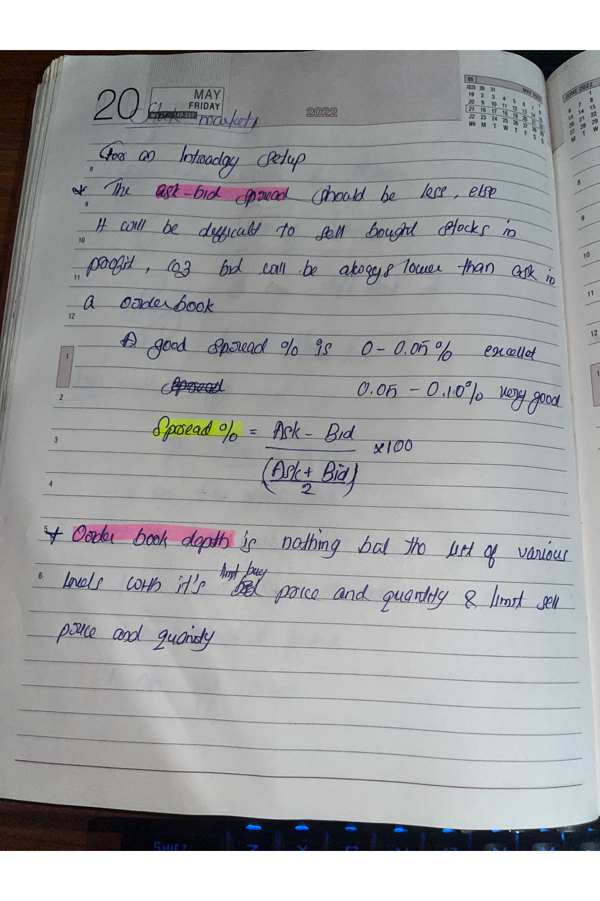

---

## Page 2 - May 21, 2022 - Saturday / Sunday 22

Printed header: `21 MAY SATURDAY 2022`; `141-224`; `Wk 21`. Lower printed label: `SUNDAY 22`.

- **Orderbook imbalance** help to find the pressure.

**Imbalance**:

```text
                 BidQty - Ask Quantity
Imbalance = --------------------------------
                 BidQty + AskQty
```

[Transcription note: There is no clearly readable operator between “BidQty” and “AskQty” in the handwritten denominator. It has not been supplied from outside the source.]

A negative value means more visible selling quantity.

A positive value means more visible buying quantity.

**But orders can be cancelled, modified or replenished.**

### How to find a good liquidity stock?

Ans: Average traded value greater than 20 Cr and have a tight bid-ask spread looks like a good liquid stock.

### Relative volume (RVOL)

This will help to find the trading activity.

```text
       Current Volume or Cumulative Volume
RVOL = ------------------------------------------------------------
       Average volume until the same time for last 10 days
```

[Transcription note: “until” is inserted below the denominator near “the same time”.]

### Original page image

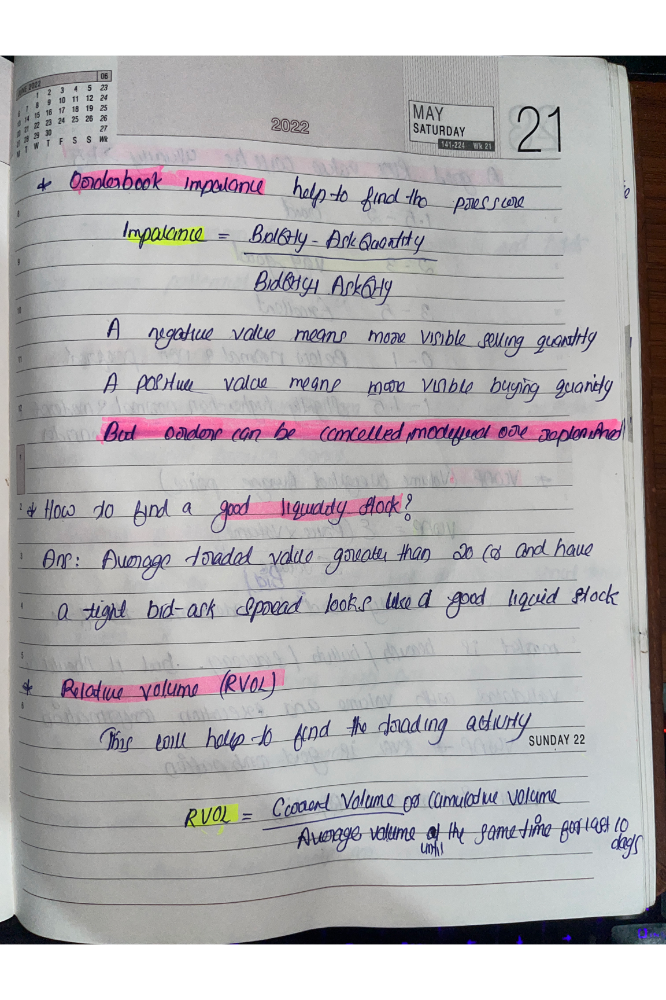

---

## Page 3 - May 23, 2022 - Monday

Printed header: `23 MAY MONDAY 2022`; `Wk 22`; `143-222`.

**A good RVOL value will be usually > 1.5.**

| RVOL | Description |
| --- | --- |
| 1.5 - 2 | Good |
| **2 - 3** | **very good** |
| 3 - 5 | Excellent |
| 0 - 1 | Below normal & not preferred |
| 1 - 1.5 | Slightly higher than normal & moderate to consider |

### VWAP (Volume Weighted Average price)

```text
VWAP = Σ(Price × Volume) / Σ Volume
```

VWAP usually used to understand ~~the~~ if the market is bearish / bullish / sideways. But it should be validated with volume and execution confirmation.

VWAP + RVOL is good combination.

VWAP Reclaim and Rejection

### Original page image

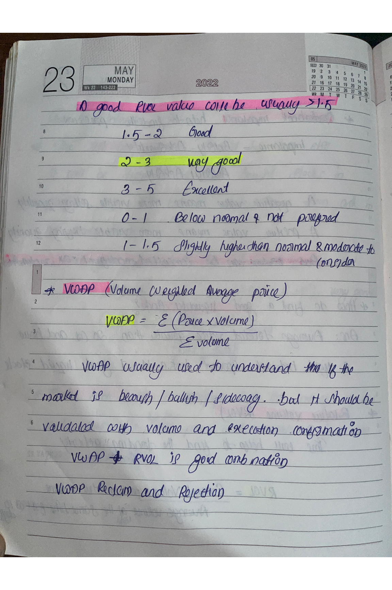

---

## Page 4 - May 24, 2022 - Tuesday

Printed header: `24 MAY TUESDAY 2022`; `144-221`; `Wk 22`.

### VWAP Reclaim

Price move from below VWAP to above it and holds there means potential bullish signal.

### VWAP Rejection

Price approaches VWAP from below and get rejected means potential bearish signal.

### Support & Resistance

I know the basic concepts, here discussing about how to calculate it.

**Method 1.** find swing high and swing lows of 5 candles,

Swing high means 2 candles before and 2 candles after will be lower than middle one.

If these swing points are laying inside a tolerance

[Transcription note: Sentence continues on page 5.]

### Original page image

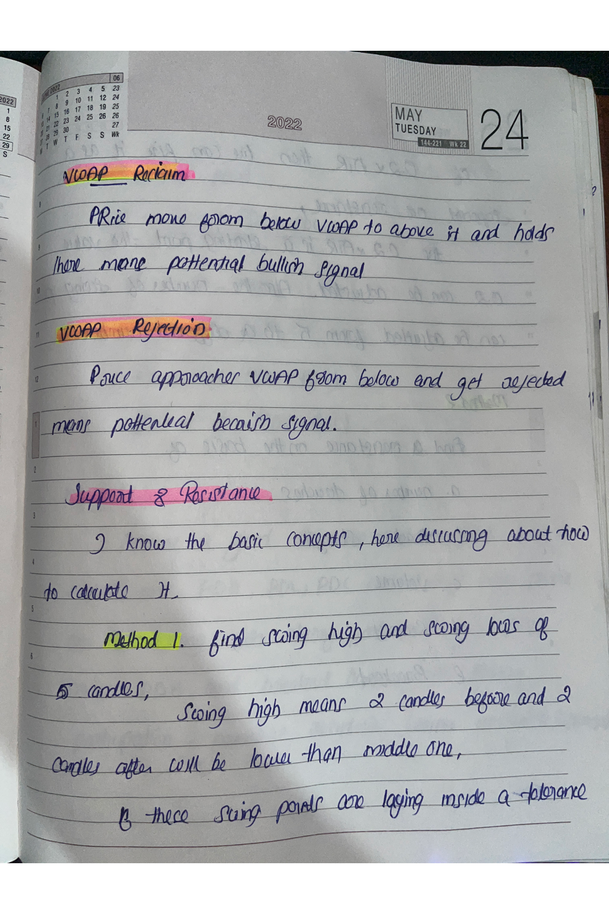

---

## Page 5 - May 25, 2022 - Wednesday

Printed header: `25 MAY WEDNESDAY 2022`; `Wk 22`; `145-220`.

[Transcription note: Continuation from page 4.]

of 0.2 × ATR then we can fix it as a support or resistance,

the 0.2 × ATR is a starting point the value 0.2 can be adjusted. Also the number of swing points can be adjusted from 5 to a different number.

### Method 2

Find a resistance on the basis of

- a. number of touches
- b. Reaction Strength
- c. Volume
- d. Recency
- e. Breakout

### Original page image

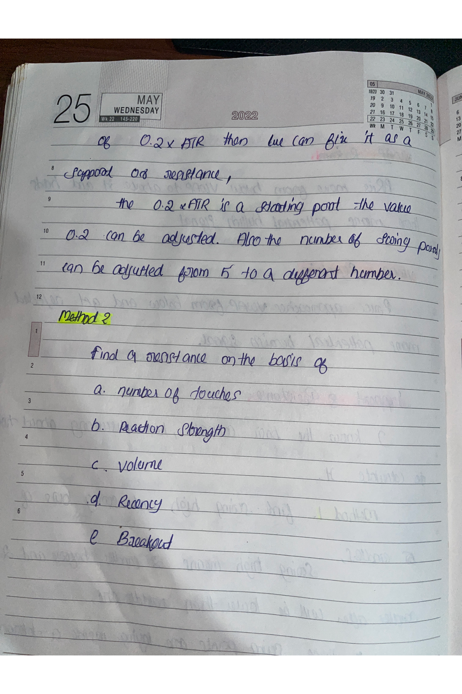

---

## Page 6 - May 26, 2022 - Thursday

Printed header: `26 MAY THURSDAY 2022`; `146-219`; `Wk 22`.

### Method 3 - Pivot point

```text
P = (PDH + PDL + PDC) / 3

R₁ = 2P - PDL

S₁ = 2P ÷ PDH

R₂ = P + (PDH - PDL)

S₂ = P - (PDH - PDL)
```

[Transcription note: The symbol in the S₁ line looks like “÷” in the source and is reproduced that way. The S₂ label is overwritten. These formulas have not been corrected.]

### Method 4

Assume a good resistance and support zone based on PDH, PDL, PDC and Today's open price on correlating with strong participation. If price cross PDH and breakout happen with strong participation, previous resistance become potential support.

[Transcription note: The final word “support” runs into the right edge of the photograph.]

### Original page image

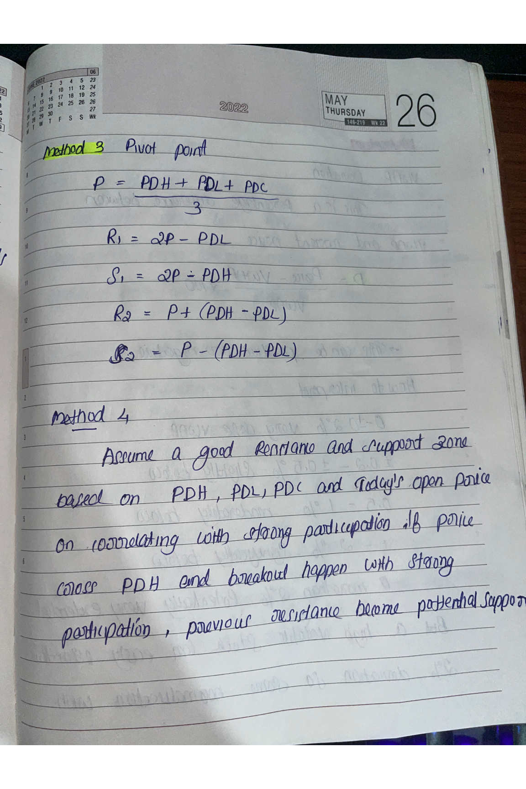

---

## Page 7 - May 27, 2022 - Friday

Printed header: `27 MAY FRIDAY 2022`; `Wk 22`; `147-218`.

~~Momentum~~

[Transcription note: The crossed-out heading appears to read “Momentum”; it is heavily overwritten.]

### VWAP Deviation

This is a percentage difference between VWAP and current price.

```text
D = (Price - VWAP) / VWAP × 100
```

→ This can be positive or negative.

How to interpret

| Deviation | Description as written |
| --- | --- |
| 0 - ±0.2% | very close VWAP |
| ±0.2 - ±0.5% | Slightly below |
| 0.5 - 1% | moderately below |
| 1 - 2% | Significantly below |
| more than 2% | Potentially very extended |

[Transcription note: A small crossed-out mark precedes “more than 2%”. The signs and “below” descriptions are retained as written.]

But a high volatile stock can easily cross this 2% deviation so some normalization with

[Transcription note: Sentence continues on page 8.]

### Original page image

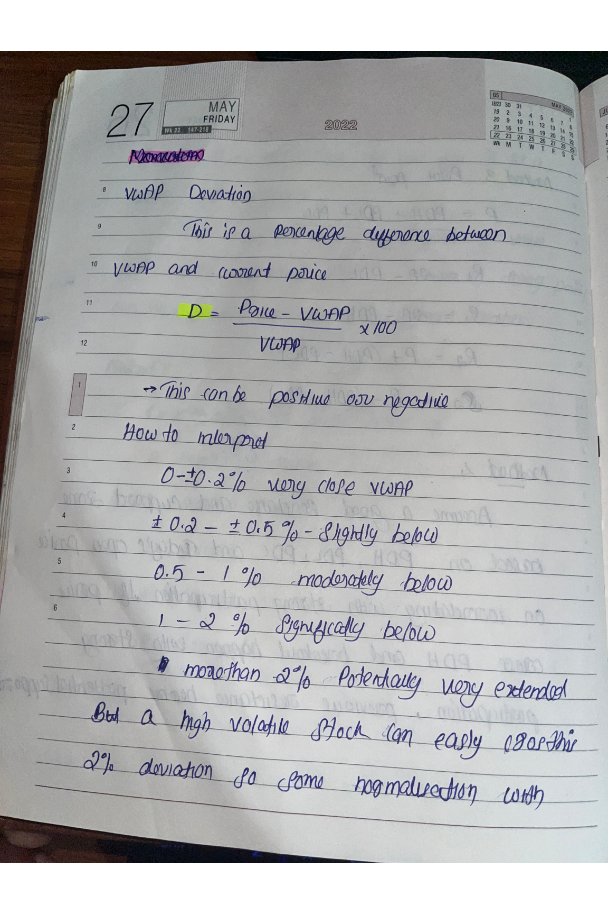

---

## Page 8 - May 28, 2022 - Saturday / Sunday 29

Printed header: `28 MAY SATURDAY 2022`; `148-217`; `Wk 22`. Lower printed label: `SUNDAY 29`.

[Transcription note: Continuation from page 7.]

volatility will be better.

Also the deviation alone cannot confirm anything.

It should be read with RVOL, selling/buying volume

~~and, check price continue making lower lows or higher highs,~~ [unclear overwritten writing] and other [crossed-out/illegible writing] indexes,

[Transcription note: The text after “highs” contains overwritten characters that cannot be confidently transcribed.]

### Example (1): Price far below VWAP but still falling

[Transcription note: “far” is inserted above “Price below”.]

```text
Deviation = -2%
RVOL = 3
Selling volume ↑
Price continue making lower lows,
```

### (2) Price below VWAP but selling pressure weakens

```text
Deviation = -2%
Price approach historical support
Selling volume ↓
Sellers repeatedly fail to push price lower
Buyers start lifting the Ask
Price start recovering
```

### Original page image

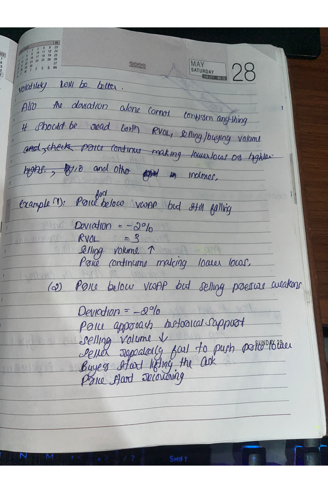

---

## Page 9 - May 30, 2022 - Monday

Printed header: `30 MAY MONDAY 2022`; `Wk 23`; `150-215`.

[Transcription note: A diagonal hand-drawn box above the heading contains writing that appears to read “General abt”; the second word is uncertain.]

### Average True Range (ATR) (volatility)

```text
TR = max {
    High - Low
    |High - Previous Close|
    |Low - Previous Close
}
```

[Transcription note: In the third line “High” is crossed out and replaced by “Low” underneath. A closing absolute-value bar on that line is not clearly visible and has not been added.]

High - high of candle

Low - low of [crossed-out word, unclear] candle

Previous close - close of previous candle.

**ATR** = Average of some candles

typically [crossed-out mark] (last 14 candles)

### How to find stop loss from ATR

```text
Stop distance = 1.5 × ATR    (1.5 is a typical value)
```

So:

```text
Stop loss = Entry price - Stop distance
```

[Transcription note: “Current” appears crossed out and is replaced by “Entry” before “price”.]

### Original page image

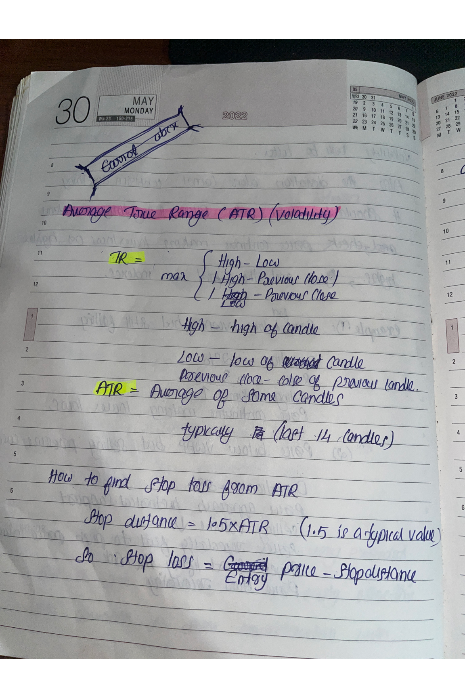

---

## Page 10 - May 31, 2022 - Tuesday

Printed header: `31 MAY TUESDAY 2022`; `151-214`; `Wk 23`.

From here we can calculate the position size and target profit with the planned risk reward ratio.

```text
Position size = Maximum Risk / Stop distance
```

With 1:2 risk reward ratio

```text
Target price = Entry price + 2 × Stop distance
```

### Average True range percentage

```text
ATR% = ATR / Stock price × 100
```

### Relative ATR

```text
                       Current ATR
Relative ATR = --------------------------------------------------
               Historical Avg ATR at same time of last 20 Days
```

Relative ATR will help to identify if stock has a good volatility.

[Transcription note: A long vertical blue pen line crosses the right side of this page.]

### Original page image

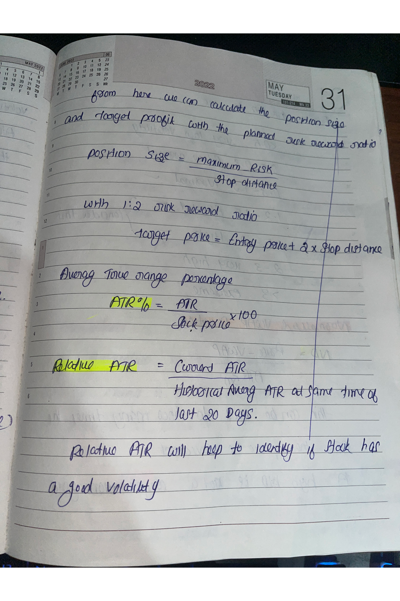

---

## Page 11 - June 1, 2022 - Wednesday

Printed header: `01 JUN WEDNESDAY 2022`; `Wk 23`; `152-213`.

Relative ATR can be the

| Relative ATR | Description | Original mark |
| --- | --- | --- |
| < 0.5 | very low volatility | |
| 0.5 - 0.8 | Below normal | |
| 0.8 - 1.2 | Normal | ✓ |
| 1.2 - 1.5 | Elevated | ✓ |
| 1.5 - 2 | High | ✓ |
| 2 - 3 | very high | |
| > 3 | extreme | |

[Transcription note: A brace beside the “Elevated” and “High” rows is labelled “Consider this”.]

### Normalized VWAP Deviation

```text
ND = (Price - VWAP) / ATR₅ₘ
```

This can be used to how many times the ATR the price is deviated.

A high ND is not a confirmation for

[Transcription note: Sentence continues on page 12.]

### Original page image

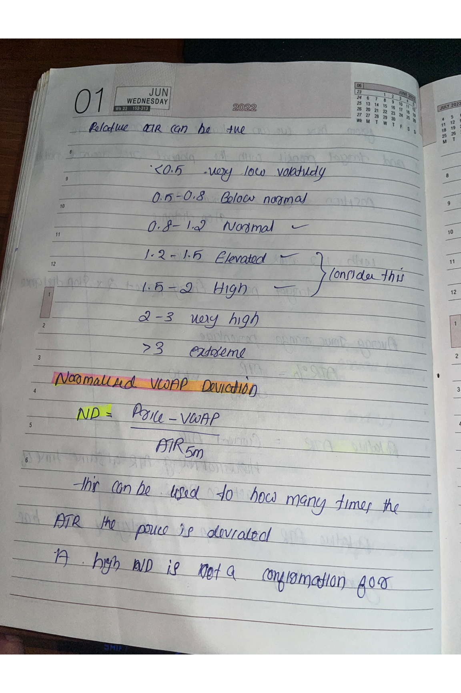

---

## Page 12 - June 2, 2022 - Thursday

Printed header: `02 JUN THURSDAY 2022`; `153-212`; `Wk 23`. Right-side printed tab: `JUNE`.

[Transcription note: Continuation from page 11.]

reversal, confirm it with

- Selling pressure should weakening
- Price stop making lower lows
- Buyers begin absorbing aggressive selling
- Price start reclaiming a nearby level
- The potential target towards VWAP offer sufficient reward relative to risk

### Momentum

Momentum is the answer for; is the stock actually moving in a direction, and is the movement strengthening or weakening?

```text
      Current price - Previous price of reference candle
ROC = --------------------------------------------------- × 100
              Previous price of reference candle
```

Previous price of reference → we can select any previous candle.

### Original page image

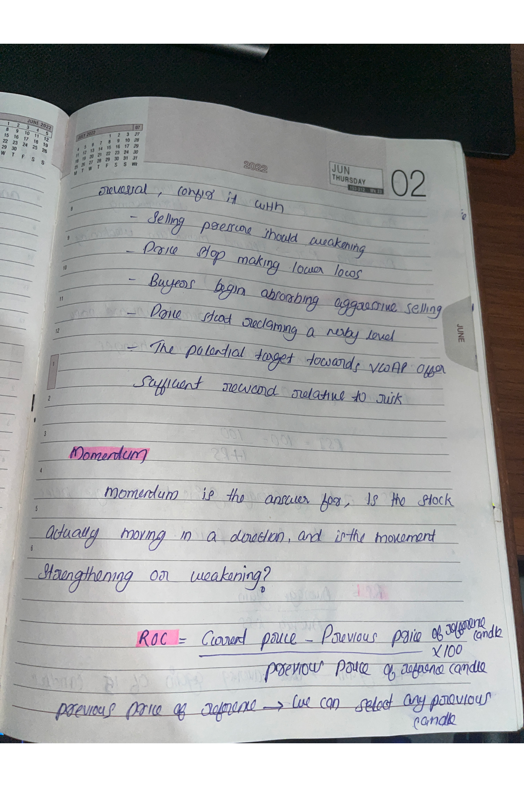

---

## Page 13 - June 3, 2022 - Friday

Printed header: `03 JUN FRIDAY 2022`; `Wk 23`; `154-211`.

An increasing ROC → Upward momentum may be strengthening.

Decreasing ROC → Upward momentum weakening.

### Relative Strength Index (RSI)

RSI measure strength of recent upward price change relative to downward price changes.

It ranges from 0 - 100.

```text
RSI = 100 - 100 / (1 + RS)
```

RS → ratio of average gains to average losses over the selected period.

```text
RS = Average gain / Average loss
```

Average gain → [crossed-out/illegible word] average gain of 15 candles.

[Transcription note: The handwritten count reads “15”; it has been retained.]

### Original page image

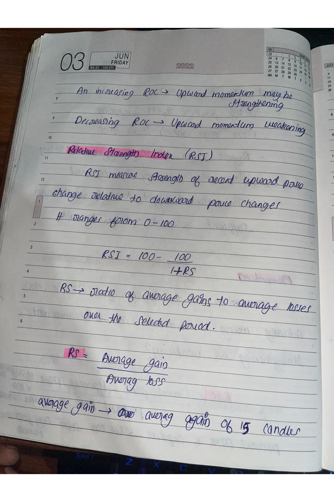

---

## Page 14 - June 4, 2022 - Saturday / Sunday 05

Printed header: `04 JUN SATURDAY 2022`; `155-210`; `Wk 23`. Lower printed label: `SUNDAY 05`.

Gain or loss is taken from current closing price - last closing price.

[Transcription note: “or loss” and “closing” are inserted above the line.]

If RS = 1 → Average gain & average loss more or less same.

| RSI condition as written | Adjacent numerical notation as written | Description |
| --- | --- | --- |
| RSI < 30 | [overwritten notation, unclear]; < -2.3 | Strong recent downward |
| RSI < 40 | -2.3 - -1.5 | Bearish |
| RSI < 50 | 1.5 - 1 | Relatively weak momentum |
| RSI < 60 | 1 - 1.5 | Relative positive momentum |
| RSI < 70 | 1.5 - 2.3 | Stronger bullish momentum |
| RSI > 70 | 2.3 and above | Strong recent upward momentum |

[Transcription note: The first row has overwritten writing between “RSI < 30” and “< -2.3”; parts resemble “RS” and a fraction, but are not confidently legible. The “4” in “40” is overwritten. The first three rows contain ambiguous dash placement. Their visible numerical notation is reproduced without converting it into corrected RS ranges. A small dash also appears immediately after “50” before the written “1.5 - 1”.]

RSI can between 0 - 100.

**RS can be smoothened further with more complicated equations.**

### Moving Average Slope

[Transcription note: A small crossed-out mark appears before this highlighted heading.]

A moving average smooth prices fluctuations and help identify the direction of the underlying movement.

### Original page image

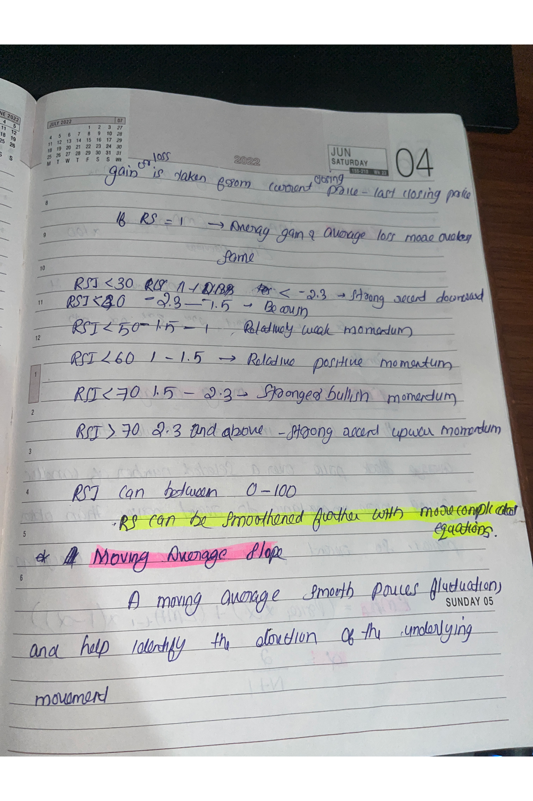

---

## Page 15 - June 6, 2022 - Monday

Printed header: `06 JUN MONDAY 2022`; `Wk 24`; `157-208`.

This is the slope of change of EMA₂₀.

```text
Slope % = (EMA_current - EMA_previous) / EMA_previous × 100
```

EMA_previous → EMA₂₀ of a previous candle it can be ~~1, 2,~~ first, 2nd, 3rd or nth candle.

[Transcription note: The crossed-out numerals before “first” appear to be “1, 2”.]

### EMA - Exponential moving Average

It's a technical index that calculate the average stock price over a selected number of candles giving more importance to recent prices than older prices. So recent prices will have more weightage.

```text
EMAₜ = (Priceₜ × α) + (EMAₜ₋₁ × (1 - α))

α = 2 / (N + 1)
```

### Original page image

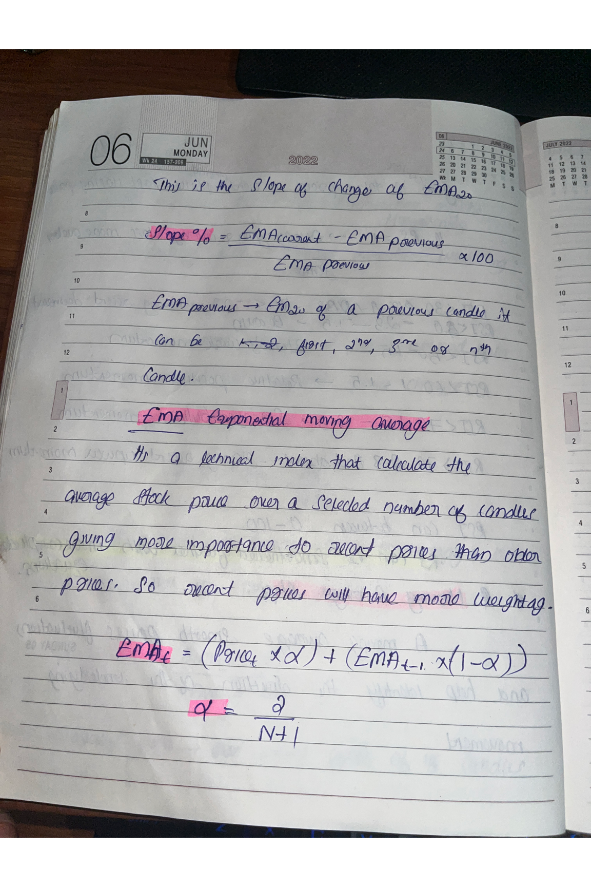

---
